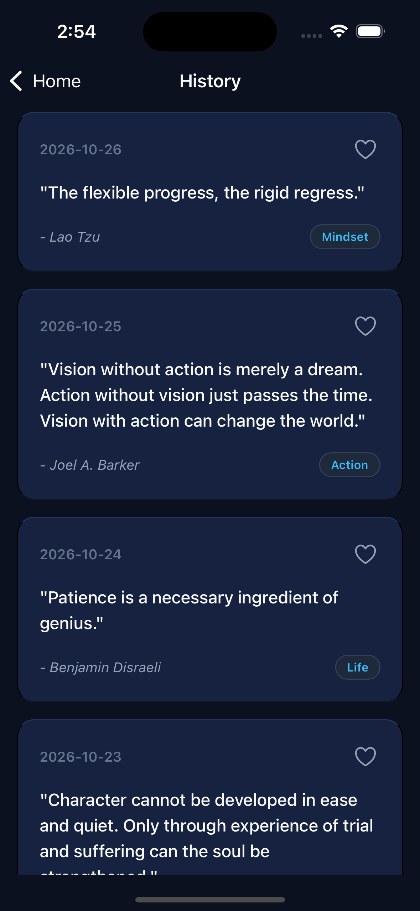
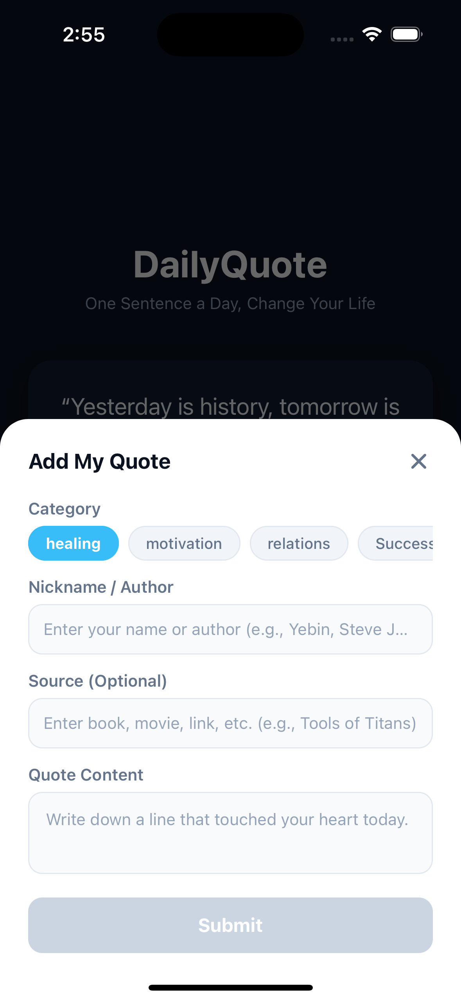

# Daily Quote

**A Mobile App for Daily Inspiration**

Daily Quote is a mobile application that provides daily inspirational quotes to help users find motivation and positivity in their everyday lives.

The app is built with React Native and includes a separate Node.js backend.

## Features

- **Daily Quotes** – Browse inspirational quotes through a simple mobile interface.
- **Favorites** – Save and manage favorite quotes.
- **Quote History** – Browse previously viewed quotes.
- **Multilingual Support** – Support for multiple languages using i18next.
- **Local Data Storage** – Persist favorite quote data using AsyncStorage.
- **Push Notification Infrastructure** – Firebase Cloud Messaging integration.

## Tech Stack

### Frontend

| Technology | Purpose |
|---|---|
| React Native | Cross-platform mobile development |
| TypeScript | Type-safe development |
| React Navigation | Screen navigation |
| i18next | Internationalization |
| AsyncStorage | Local data persistence |
| Firebase Cloud Messaging | Push notification integration |

### Backend

| Technology | Purpose |
|---|---|
| Node.js | Backend runtime |
| Express.js | API server |
| Firebase Admin SDK | Firebase server-side integration |
| node-cron | Scheduled task management |

## Screenshots

<p align="center">
  
  
  
  
</p>

## Getting Started

### Frontend

```bash
cd frontend
npm install
npm run ios
```

To run the Android application:

```bash
npm run android
```

### Backend

```bash
cd server
npm install
npm run dev
```

**Requirements:** Node.js 22.11.0 or later.

Additional Firebase configuration may be required to run backend and notification features.

## Developer

**Yebin Oh**

GitHub: [HelloYebin](https://github.com/HelloYebin)

This project was developed as a personal project to explore mobile application development, backend integration, local data persistence, and internationalization.
